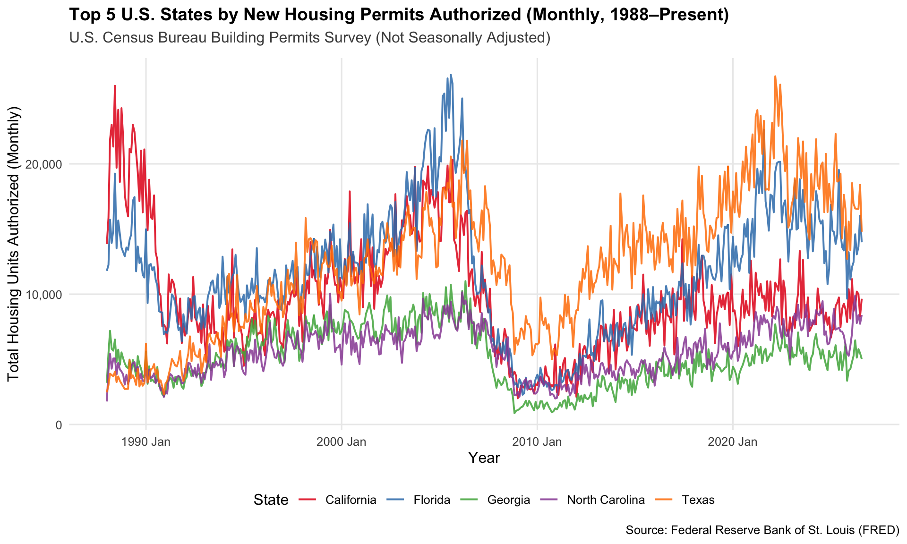

# Discussion 1.1: Application of Time Series

**Author:** Jordan Blackman  
**Course:** ADS 506 – Applied Time Series Analysis  
**Topic:** U.S. Residential Building Permits (Top 5 States All-Time)

---

## 1. Time Series Visualization

Below is the monthly time series plot showing new privately-owned housing units authorized by building permits from **January 1988 through Present** for the top 5 states in cumulative permit volume: **Texas, Florida, California, North Carolina, and Georgia**.

*(Note: The plot is fully reproducible via an R script using `fpp3` and `tsibble`, pulling directly from the public FRED repository.)*

---

## 2. Examination of the Data Source & Time Series Components

### Data Source & Public Accessibility
* **Originating Source:** U.S. Census Bureau & U.S. Department of Housing and Urban Development (HUD), via the **Building Permits Survey (BPS)**.
* **Access Platform:** Publicly available through the Federal Reserve Bank of St. Louis (FRED) under Category 32410 (Series IDs: `TXBPPRIV`, `FLBPPRIV`, `CABPPRIV`, `NCBPPRIV`, `GABPPRIV`).
* **Integrity:** Highly structured, machine-readable monthly observations with zero missing timestamps across more than 460 months (over 38 complete annual cycles).

### Time Series Components Exhibited
1. **Level:** 
   * Distinct volume baselines separate the top three megastates (Texas, Florida, and California averaging between 9,500 and 12,500 monthly permits) from the fast-growing secondary hubs (North Carolina and Georgia averaging 5,000 to 5,500 monthly permits).
2. **Trend & Cyclicity:**
   * A prolonged structural upward trend is evident in Sunbelt states (Texas, Florida, North Carolina) driven by demographic migration, contrasted with California where regulatory constraints have kept post-2010 permit volume well below its mid-2000s peak.
   * Clear multi-year macroeconomic cycles: a major boom through 2005, a sharp contraction during the 2008 Great Financial Crisis, a steady decade-long post-recession expansion, a post-2020 pandemic surge, and a noticeable leveling off beginning in 2022.
3. **Seasonality:**
   * Pronounced annual seasonality ($s = 12$) is visible across all five series, characterized by a rapid surge in permit filing during early spring/summer (March–June) to prepare for the prime construction season, followed by a steep drop during the winter months (November–January).
4. **Noise & External Shocks:**
   * High-frequency irregular variations caused by localized weather events (e.g., severe hurricanes in Florida disrupting municipal office operations), tax policy deadlines, and sudden macroeconomic shocks (such as the brief April 2020 COVID shutdown and rapid subsequent rebound).

### Forecastability Assessment
This dataset has high forecastability compared to efficient financial markets because physical construction planning follows well-established biological and operational calendars. Because the seasonal component is deterministic and persistent, seasonal models (e.g., Seasonal ARIMA or Holt-Winters ETS) will readily capture the intra-year oscillation. Furthermore, because municipal permits are filed 1 to 3 months prior to ground-breaking, incorporating **lagged mortgage rates (30-Year Fixed)** and **construction material PPI** as exogenous regressors (ARIMAX / Dynamic Harmonic Regression) will significantly enhance 6- to 12-month-ahead predictive accuracy over pure univariate baselines.

---

## 3. Potential Business Applications & Interests in Time Series

I am interested in using time series forecasting to bridge macroeconomic indicators with real-world operational decision-making. Three concrete business problem statements I would like to explore include:

1. **Construction Supply Chain & Inventory Optimization (Mitigating the Bullwhip Effect):**
   * *Problem:* Suppliers of raw materials (softwood lumber, concrete, electrical conduit) frequently over- or under-order due to delayed signals from construction sites. 
   * *Application:* Using regional building permit forecasts as a 3-month leading indicator to dynamically optimize warehouse stocking levels and reduce holding costs across regional distribution centers.
2. **Monetary Policy Transmission & Builder Capital Allocation:**
   * *Problem:* How quickly and severely do Federal Reserve interest rate hikes dampen residential construction commitments across different demographic markets?
   * *Application:* Dynamic regression modeling to evaluate how rising 30-year fixed mortgage rates differentially impact permit pull velocity between high-elasticity migration states (Texas and Florida) versus supply-constrained states (California).
3. **Hierarchical Urban Infrastructure & Utility Capacity Planning:**
   * *Problem:* Municipal utility providers (power, water, broadband) must budget capital infrastructure expansions years before subdivisions are completed.
   * *Application:* Implementing hierarchical time-series reconciliation (`fable::reconcile` with `min_trace`) to forecast permit growth from state totals down to regional metropolitan statistical areas (MSAs), ensuring coherent forecasts across geographic tiers for multi-year capital budget allocation.
